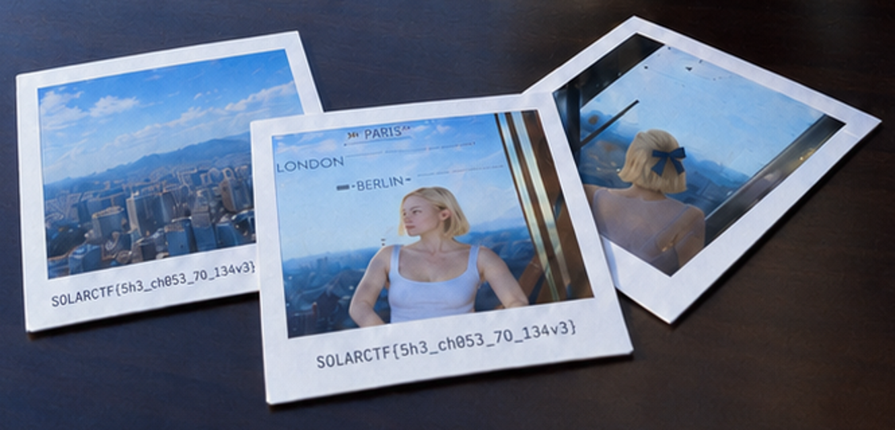

# За кадром

**Турнир:** SolarCTF · **Категория:** osint

**Статус:** Решено.

## Кратко

Ник на исходном фото ведёт к Dreamwidth-блогу. Флаг напечатан на рамках полароидов в связанном с условием посте.

## Решение

### 1. Прочитать ник и найти профиль

При увеличении профиля на экране читается `m1moletno`. Соответствующий LiveJournal не зарегистрирован; [Dreamwidth-профиль](https://m1moletno.dreamwidth.org/) совпадает по оформлению и фотографии еды.

### 2. Найти связанное изображение

В [записи от 18 марта 2026](https://m1moletno.dreamwidth.org/1007.html) находится [фотография 3518.png](https://m1moletno.dreamwidth.org/file/3518.png). На столе лежат полароиды, один — с девушкой. На их белых рамках напечатан флаг. Это соответствует подсказке о внешности; другие текстовые строки в поздних постах не нужны. Независимая проверка подтвердила чтение символов и связь фото с entry-1007 в сохранённом HTML.



## Флаг

```text
SOLARCTF{5h3_ch053_70_134v3}
```
