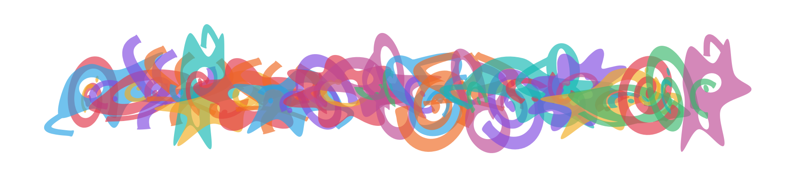

# Weaver

**Турнир:** SolarCTF · **Категория:** misc

**Статус:** Решено.

## Кратко

Скрытый текст формируется контекстными подстановками цветного OpenType-шрифта. Обращение правил шрифта и alpha-compositing восстанавливает строку.

## Решение

### 1. Извлечь преобразования шрифта

Страница загружает `glyphs.otf?v=interlace-1`; JavaScript только обрамляет ввод квадратными скобками. GSUB lookup 0 идёт слева направо, lookup 261 — справа налево, lookup 522 преобразует соседние пары. GPOS задаёт смещения по X и Y и advances 300 вместо 1300. COLR/CPAL задают цветные слои с alpha 168/255.

### 2. Восстановить строку справа налево

Крайняя правая фигура соответствует `g54151`. Из известной `}` обратить GSUB и для очередной пары перебрать символы алфавита. Правдоподобность оценивается обратным alpha-compositing: неверная пара требует RGB за пределами 0…255. Калибровка: font size 178 px, baseline 601, последний глиф x=1711, длина флага 27. Последовательность суффиксов ведёт от `d}` к `g1yph5_f0nt_gr33d}`.

### 3. Сверить полный рендер

Повторная отрисовка совпадает по фигурам, цветам и позициям. Независимый интерпретатор GSUB/GPOS подтвердил 29 глифов с обрамлением; все 1054 односимвольные альтернативы хуже. Пользователь также подтвердил правильность.



## Флаг

```text
SOLARCTF{g1yph5_f0nt_gr33d}
```
